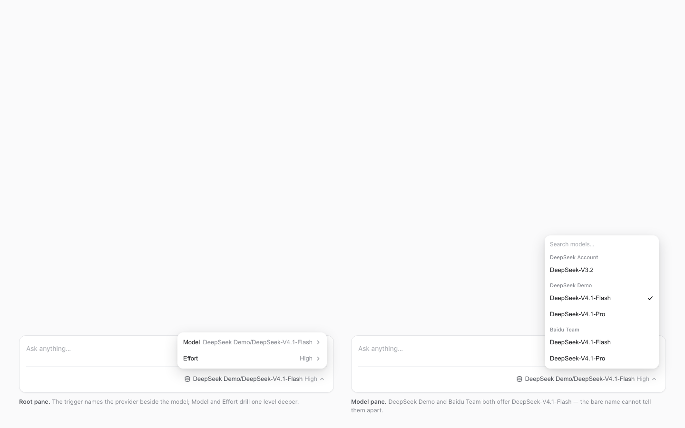

# dsh-provider-model-picker

**Provider + Model** — the composer's model control names the provider beside the model: `DeepSeek Demo/DeepSeek-V4.1-Flash` instead of `DeepSeek-V4.1-Flash`.

**English** | [简体中文](README.zh-CN.md)

[](LICENSE)
[](https://github.com/icrefin/dsh-provider-model-picker/releases/tag/v0.3.4)
[](https://github.com/icrefin/dsh-provider-model-picker/actions/workflows/ci.yml)
[](https://github.com/icrefin/dsh-provider-model-picker/commits/main)
[](https://github.com/icrefin/dsh-provider-model-picker/stargazers)
[](https://github.com/icrefin/dsh-provider-model-picker/pulls)
[](https://nodejs.org)
[](https://github.com/deepseek-ai/deepseek-harness)

## The ambiguity it removes

The shipped picker prints the catalog model name alone, which is ambiguous as soon
as two providers offer a model with the same name, or as soon as the model is not
the one you think the session is on. This plugin keeps the control exactly where
it is and adds the one fact it was missing.

```
                                    before                  after
   ┌──────────────────────────────┐  ┌───────────────────┐  ┌──────────────────────────────────┐
   │  Ask anything…               │  │ DeepSeek-V4.1-F… ▾│  │ DeepSeek Demo/DeepSeek-V4.1-F… ▾ │
   │                              │  └───────────────────┘  └──────────────────────────────────┘
   │  📊  DeepSeek-V4.1-Flash  ▾  │  ⤴ the trigger this plugin re-registers
   └──────────────────────────────┘
```

## What it contributes

| Surface | What it does |
|---|---|
| `conversation.input.model` | re-registered at a lower priority than the shipped picker, rendering this plugin's trigger (`Provider/Model` + reasoning effort) and its two-level menu |
| Locale namespace `dsh-provider-model-picker` | English and Simplified Chinese copy for the control |
| Composer row CSS variables | honours the host's `--dsh-composer-model-text-display` / `--dsh-composer-model-icon-display` compact switch like the shipped occupant |

No host route, no service, no Config: the host half (`exports["."]`) exists only so
the Loader row can carry the browser half (`exports["./client"]`).

## The label rule

| Directory state | Trigger shows |
|---|---|
| Model loaded in the catalog | `Provider/Model` — the catalog provider name, or the localized **DeepSeek Account** for the account provider |
| Model missing from the catalog (removed, or its group failed to load) | `Provider/model-id`, using the group's name when known and the raw provider id otherwise |
| No catalog yet | the shipped forms: `Loading models…`, then `Select model` |

The reasoning effort keeps its own caption beside the label
(`DeepSeek Demo/DeepSeek-V4.1-Pro · High`), and the trigger's accessible name and
tooltip use the same provider-qualified string.

**A model that advertises no reasoning levels gets no caption and no Effort row** —
the control offers only what the adapter publishes, exactly like the shipped
picker, because the host rejects an effort its adapter never advertised. For a
`dsh-llm-pi-ai` route that capability is the model entry's `reasoningEfforts`
(omit the field to keep the installed catalogue's own metadata):

```yaml
- id: llm-pi-ai
  name: "@deepseek-ai/dsh-llm-pi-ai"
  config:
    providers:
      baidu-team:
        models:
          - id: deepseek-v4.1-flash
            name: BD DeepSeek-V4.1-Flash
            # level name → the wire value dispatch sends; only `off` may be empty
            reasoningEfforts:
              low: low
              medium: medium
              high: high
```

The level names are `off`, `minimal`, `low`, `medium`, `high`, `xhigh`, `max`.
Declaring them is a host-configuration change, not a plugin one: the same levels
then appear in `/model` and in this control's Effort row.

## Screenshot



Both panels come from `tools/preview.mjs`, which renders the built bundle outside
the GUI over a fake catalog. On the left, the trigger names the provider and the
root pane drills into Model and Effort; on the right, the model pane lists every
provider group — and **DeepSeek Demo and Baidu Team both offer
`DeepSeek-V4.1-Flash`**, which the bare model name cannot tell apart.

## How the shadow works

`conversation.input.model` is a **`single`** slot — one occupant per cell, and the
slot registry renders the **lowest live `priority`**, keeping the higher entry
registered. The shipped picker (`@deepseek-ai/dsh-client-ui-model-selection`)
registers at the default `0`; this plugin registers at `-1`.

That choice buys three things:

- **The shipped picker stays installed.** It is not removed, so nothing else that
  refers to it breaks, and the `/model` command popup is untouched.
- **A crash falls back, not blanks.** The registry supervises entries; a component
  that throws abdicates its cell and the shipped trigger renders again.
- **The data is shared.** Both the menu here and `/model` read the same
  per-session directory instance (`ctx.modelDirectories`), so a switch made in one
  is what the other shows next.

If another occupant already holds `priority: -1`, the registration is refused —
the plugin logs and leaves the shipped picker alone rather than breaking the
composer's own registration.

Because shadowing the seat means owning it, the plugin also ships the picker
underneath: the root Model/Effort cells, provider-grouped model list, search past
four models, reasoning-effort levels, pending spinner, keyboard navigation
(`↑`/`↓` walk rows, `Tab` accepts or leaves a drilled pane, `Escape` back/closes),
and an in-menu error strip with Retry.

The registration is held by an effect, and the effect hands back the slot's own
disposer: unloading the plugin removes the occupant instead of leaving a dead
entry in the registry, at which point the shipped picker renders again.

### Why it declares two services it never reads

`inject` lists `remote` and `remote.session`, which this plugin never touches
directly. They are there for the **callee**, not the caller.

`ctx.modelDirectories` is a cordis **service proxy**: it rebinds `this` to the
*caller's* context for the duration of the call. `directoryFor()` builds a
session's directory from `this.ctx.remote.session` — but only on a **cache miss**,
i.e. the first call for a session that no other surface has warmed yet. So the
call succeeds or dies depending on *who asked first*:

| Who calls first for that session | Result |
|---|---|
| The shipped picker or the `/model` popup (they declare `remote.session`) | Directory built and cached; a later call from anywhere is a cache hit |
| This plugin, at `priority: -1`, before the shipped entry renders | `cannot get property "remote.session" without inject` |

That is why the defect looked intermittent and session-shaped: any session whose
directory happened to be warm worked, and a **session switch** — a new session,
this entry first — failed every time. The shipped package declares the same two
services for the same reason.

`test/support.ts` enforces the rule in its directory double, so dropping either
declaration fails the suite instead of the GUI.

## Requirements

- **Node.js >= 22.17** and **pnpm 11.8.0** — the version pinned through
  `packageManager`, which `corepack enable` picks up.
- **DeepSeek Harness `0.2.0-rc.2`**, the release this plugin's peer dependencies
  and its `SlotMap` typing are built against. A wrong slot id or option fails the
  typecheck.
- **The shipped model picker stays enabled**, since this control reads the
  per-session directory service it publishes.
- **`lib/` is not committed.** The published tree is TypeScript source, so build
  before installing the bundle.

## Install

```sh
git clone https://github.com/icrefin/dsh-provider-model-picker.git
cd dsh-provider-model-picker
pnpm install
pnpm build                       # tsc -> lib/, tsdown -> lib/client.js
sh scripts/install.sh            # packs dist/dsh-provider-model-picker-0.3.4.tgz, prints the install steps
```

`pnpm check` runs everything CI runs — `tsc` over the host half and the browser
half, the bundle build, then 81 vitest cases in six files:

```sh
pnpm check                       # typecheck both halves, build, 81 tests
```

Install the tarball from **Settings → Plugins**, or with a CLI-managed profile:

```sh
sh scripts/install.sh --profile <profile>
```

Adding a bundle to a running profile needs a **restart**: the harness computes its
module resolution at boot, so an entry installed while it runs reports "failed to
import" until the next start.

Three rules that follow from how a profile pins a local install:

- **The profile stores the tarball path**, not the package: its `package.json` gets
  `"dsh-provider-model-picker": "file:…/dist/dsh-provider-model-picker-<version>.tgz"`.
  Deleting or replacing that file makes the *next* install fail with `ENOENT`
  before it can update anything. Keep the tarball, or remove the bundle first and
  install the new version after.
- **Bump the version for every change.** Reinstalling the same version is a silent
  no-op.
- **A client half installed into a running profile may not reach the open page.**
  The host row goes active immediately, but the page only loads the bundles its
  boot graph handed it. If the composer still shows the old control after an
  install, reload the window and, if that does not take, restart the app.

## Usage and configuration

Nothing to configure: the plugin has no Loader config, no settings section and no
stored state. Install it and the composer's model control is the provider-named
one; `/model` keeps working and reads the same per-session directory, so a switch
made in either surface is what the other shows next.

| Interaction | Result |
|---|---|
| Click the trigger | the root pane: **Model** (the current `Provider/Model`) and **Effort** (the current level, only for a model that advertises levels) |
| Model → a provider group | that provider's models, in catalog order, account provider first |
| Type in the search field | appears past four models; matches as a case-insensitive ordered subsequence of the name, prefix hits first |
| Effort → a level | resubmits the same provider and model with the new level |
| `↑` / `↓` | walk the rows, wrapping at both ends |
| `Tab` | accepts the focused row; `Shift+Tab` steps back out of a drilled pane |
| `Escape` | steps back to the root pane, then closes and returns focus to the trigger |
| A submitted selection | a spinner on the pending row until the host answers; a rejection keeps the menu open with the reason and a Reload button |

## Failure handling

The registry retires an entry whose render throws and re-renders the cell onto the
next survivor — for this seat, the shipped picker. That is the right fallback, but
it is silent: the reason only reaches the page console, which a user without
developer tools cannot read. So the seat reports itself, and the two failure paths
are deliberately different:

- **A wiring failure** — the injection face could not resolve the session's model
  directory, or a service answered unexpectedly — prints
  `picker error: <reason> — click to use the default picker` **and stays**. The
  injection factory is the only call this plugin makes outside its own component
  tree, so a throw there retires the seat with nothing on screen to explain it;
  every step of that factory is therefore guarded, and the result is a message
  instead. Clicking the message throws, which is what hands the cell back to the
  shipped picker.
- **A render crash inside the picker** is caught by this plugin's own boundary and
  shown the same way. Neither message times out: a reason that disappears after a
  few seconds is one nobody can act on, and a silent revert is indistinguishable
  from "the plugin does nothing". Clicking hands the cell to the shipped picker,
  which is the only way an entry retires from here.
- `console.info('[dsh-provider-model-picker] shadowed …')` on registration and
  `console.error('[dsh-provider-model-picker] …')` on failure name the plugin, so
  "which picker am I looking at?" is answerable from developer tools.

The directory store is read through guards as well (`getSnapshot`/`subscribe`):
switching sessions can tear a session scope down under a live component, and a
throw in that read happens inside the renderer — retiring the seat for *every*
session, not just the one that went away.

Every value read from the directory snapshot is also normalised before use
(`asArray`, id fallbacks, name fallbacks): the snapshot crosses a plugin boundary,
and a shape this build did not anticipate must degrade to an empty row rather than
throw inside the renderer and cost the whole seat. That normalisation fixed the
first live defect — version 0.2.0 registered, rendered once, then threw on a
catalogue shape it did not expect and was retired.

## Limits

- **Requires the shipped picker to be enabled.** The directory service
  (`ctx.modelDirectories`) belongs to `@deepseek-ai/dsh-client-ui-model-selection`;
  with that bundle disabled there is no catalog to read, so this control could not
  select anything. The dependency is declared in `dsh.client.inject`.
- **The menu is this plugin's own.** It copies the shipped control's markup and
  CSS under its own `dpmp-` prefix instead of importing
  `@deepseek-ai/dsh-client-ui-primitives`, so a primitive revision cannot blank
  the seat — at the cost of tracking the platform's menu styling by hand.
- **One priority is reserved.** `-1` is this seat's shadow priority; another
  plugin claiming it wins or steps aside by load order, and the loser logs.

## FAQ and troubleshooting

**After installing, the composer still shows the bare model name.**
The browser half has not reached the open page yet. Reload the window; if that
does not take, restart the app. If it still does not appear, another occupant may
already hold `priority: -1` — the plugin logs
`[dsh-provider-model-picker] the model seat could not be shadowed` and leaves the
shipped picker in place.

**The control shows `picker error: …`.**
That is the wiring failure face. It stays until you click it, and clicking hands
the cell back to the shipped picker. The page console carries the full reason,
prefixed with `[dsh-provider-model-picker]`.

**The trigger shows `Provider/model-id` instead of the model's display name.**
The saved model is no longer in the loaded catalog: its provider group failed to
load, or the model was removed. The menu's warning strip names the provider that
failed, and a catalog that failed to load at all gets an error strip with a
Reload button.

**There is no Effort row.**
That model advertises no reasoning levels, so there is nothing to choose. Declare
`reasoningEfforts` on the model in the host configuration (see above) and the row
appears — here and in `/model`.

**Which picker am I looking at?**
`console.info('[dsh-provider-model-picker] shadowed "conversation.input.model" at
priority -1')` is printed when this plugin's entry is registered, and
`console.error` names it on every failure. If only the shipped messages appear,
this plugin did not register.

## License

MIT — see [LICENSE](./LICENSE).

> If this control saves you from guessing which provider a session is on, a ⭐ star
> helps other DSH users find it.

<sub>An independent plugin for DeepSeek Harness 0.2.0-rc.2 · MIT licensed.</sub>
